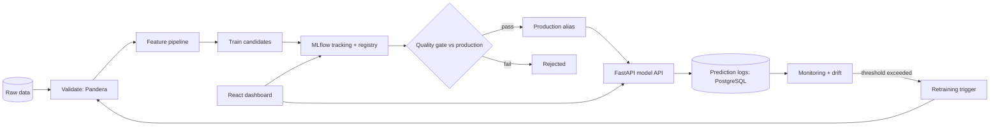
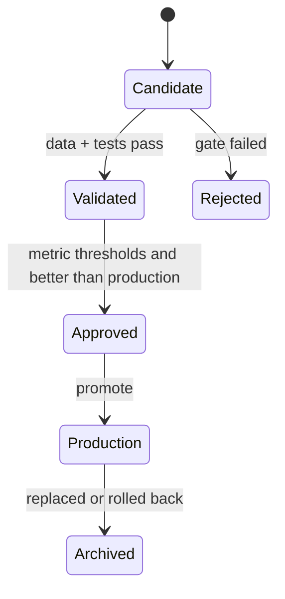

# ModelOps AI: Architecture and Roadmap

Status: **Phase 1 of 16 complete.** Items marked *(planned)* are NOT implemented yet.
This file is updated every phase so it never claims more than the code does.

## A. What it is

A platform that takes a tabular ML problem (customer churn) from raw data to a monitored production
model, with every step automated, versioned and reproducible. Training a model once is not MLOps;
MLOps is making the whole loop **repeatable, auditable and safe**: validate data, train, track,
register, gate, deploy, monitor, detect drift, retrain, compare, roll back.

## B. Why it matters

Most ML projects stop at `model.pkl`. Production ML fails for different reasons: bad input data,
training-serving skew, silent drift, a retrained model that is worse than the old one, no way to
undo a bad deploy, no record of which data produced which model. This project builds the controls
against each of those.

## C. How it differs from the first two projects

| | RAG system | Agent platform | ModelOps AI |
|---|---|---|---|
| Core | LLM + retrieval | LLM + planning + tools | Classical ML lifecycle |
| Output quality | Judged by groundedness | Judged by task success | Measured by metrics on labeled data |
| Hard problem | Grounding, citations | Autonomy, safety, recovery | Reproducibility, drift, governance |
| Key artifacts | Chunks, embeddings | Workflow state, traces | Datasets, runs, model versions, lineage |

## D. Target architecture *(planned, except where noted)*

Implemented in Phase 1: the FastAPI service shell, PostgreSQL connection, Alembic wiring,
React health page and Docker. Nothing in the ML loop exists yet.

### Model lifecycle *(planned, Phase 7)*

Further diagrams (training pipeline, inference, monitoring, retraining) are added in the phases that build them and collected in Phase 16.

## E. Technology stack and decisions

**Used in Phase 1** (versions resolve at install; exact pins are frozen before CI in Phase 13):

| Area | Choice | Reason |
|---|---|---|
| Language | Python 3.11.9 | Supported by the ML libraries used later |
| API | FastAPI, Pydantic v2, Uvicorn | Typed request/response schemas for predictions |
| DB | PostgreSQL 16, SQLAlchemy 2, psycopg 3, Alembic | Prediction logs and monitoring snapshots; migrations instead of startup-created tables |
| Frontend | React, Vite, TypeScript | Dashboard and prediction playground |
| Quality | pytest, Ruff, Black, mypy | Lint, format, types, tests |
| Infra | Docker Compose (db, api, frontend) | One-command local stack |

**Chosen for later phases** (each added only when first needed):

| Need | Choice | Why / trade-off |
|---|---|---|
| Data and ML | pandas, scikit-learn | Lightweight and sufficient for tabular churn |
| Validation | **Pandera** | Code-defined schemas, simple to unit-test; Great Expectations is heavier for one dataset |
| Data versioning | DVC (leading) vs a lightweight content-hash manifest | DVC gives a standard `dvc.yaml` pipeline but adds setup. Decided in Phase 2 once dataset size is known |
| Tracking + registry | MLflow, PostgreSQL backend store | Run comparison UI and model versions. MLflow's old "stages" are deprecated in favour of **aliases and tags**, so Candidate/Validated/Approved/Production will be modelled that way (details in Phase 7) |
| Training-serving skew | One scikit-learn `Pipeline` saved as a single artifact | The exact transformer used in training is the one used at inference |
| Drift | PSI and Kolmogorov-Smirnov (SciPy) | Standard, explainable, no extra service |
| Metrics | `/metrics` endpoint in Prometheus text format | Prometheus/Grafana servers only if they add real value |
| Retraining | CLI trigger plus an optional scheduled GitHub Actions workflow | Honest local simulation, documented as not a production orchestrator |
| CD | Build and publish image to GitHub Container Registry, deploy to a local/staging compose target | No paid cloud |

## F. Roadmap

| Phase | Scope | State |
|---|---|---|
| 1 | Foundation: structure, backend, frontend, Docker, PostgreSQL, health | **done** |
| 2 | Dataset and ingestion | not started |
| 3 | Data validation | not started |
| 4 | Feature engineering | not started |
| 5 | Model training and evaluation | not started |
| 6 | MLflow tracking | not started |
| 7 | Model registry, promotion, lineage | not started |
| 8 | Inference API | not started |
| 9 | Docker: full stack with MLflow | not started |
| 10 | Monitoring | not started |
| 11 | Drift detection | not started |
| 12 | Retraining and rollback | not started |
| 13 | CI/CD | not started |
| 14 | Frontend polish | not started |
| 15 | Testing and reliability | not started |
| 16 | Documentation and portfolio | not started |

## Demo vs production

| Item | Now | Real production would need |
|---|---|---|
| DB credentials | Dev password in `.env` | Secret manager, managed PostgreSQL, TLS, backups |
| Frontend container | Vite dev server | Static build behind nginx/CDN |
| Layout | `tests/` at the root covers both `backend/` and `src/` | Same; CI will run it |
